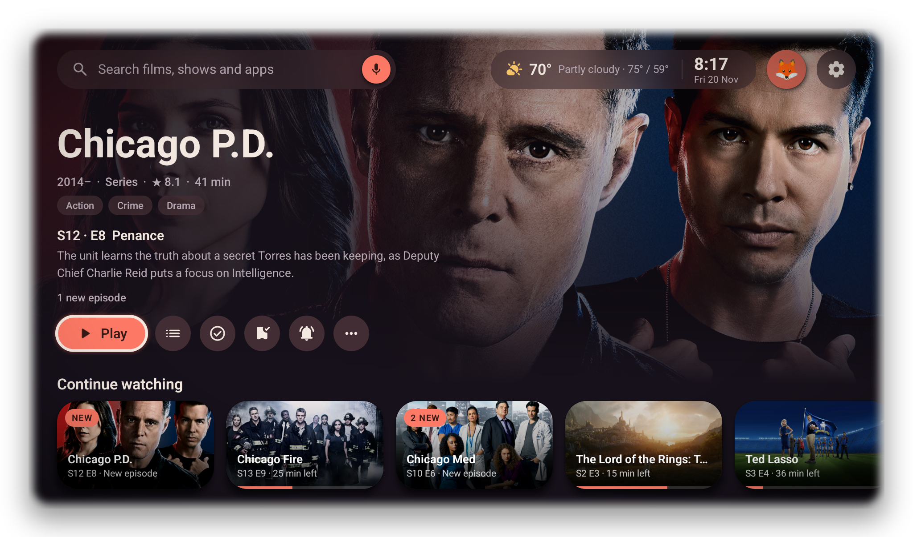
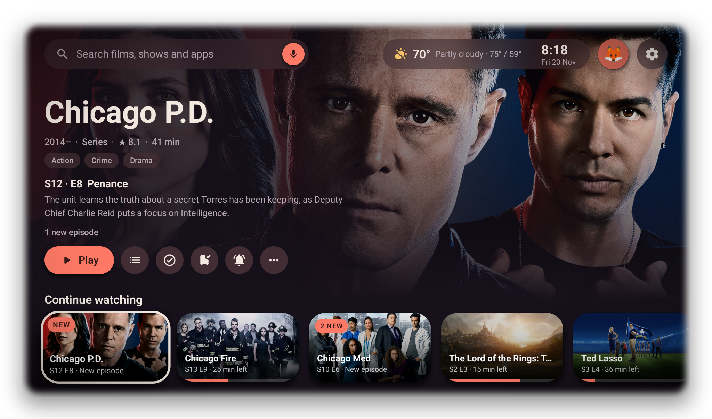
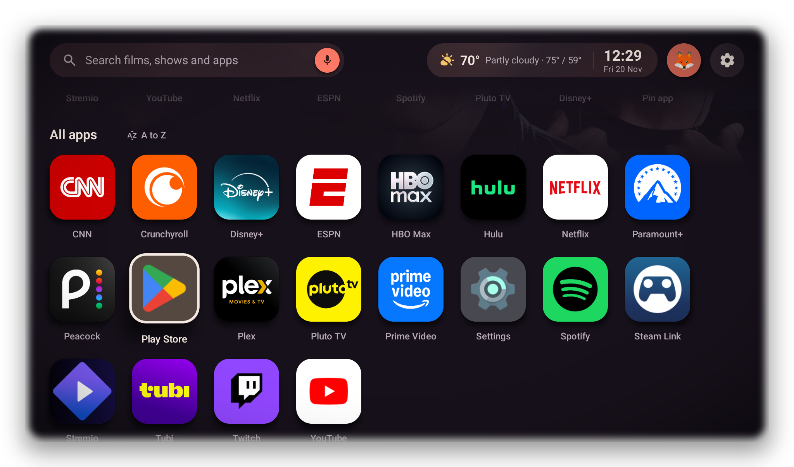
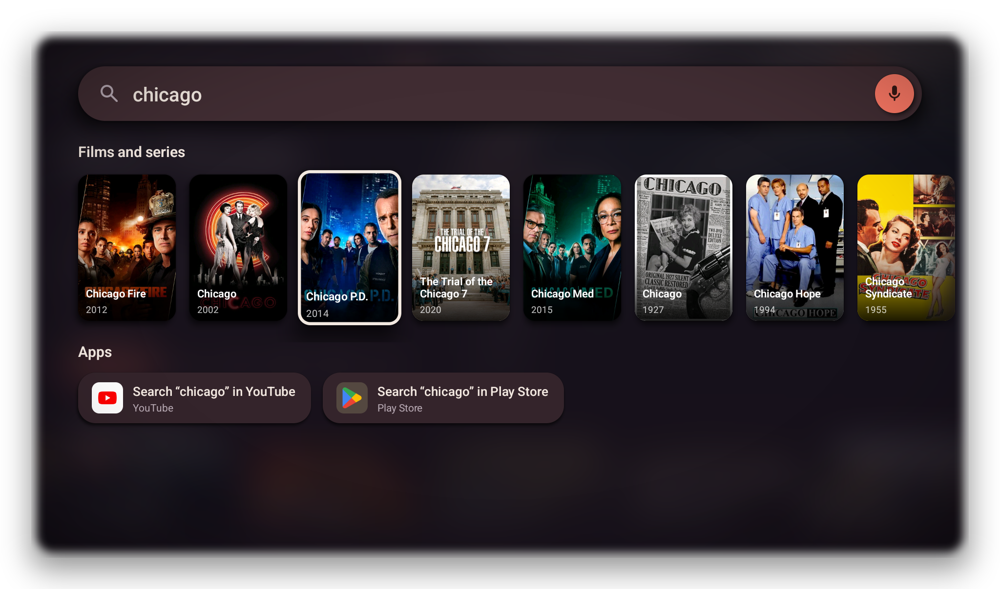
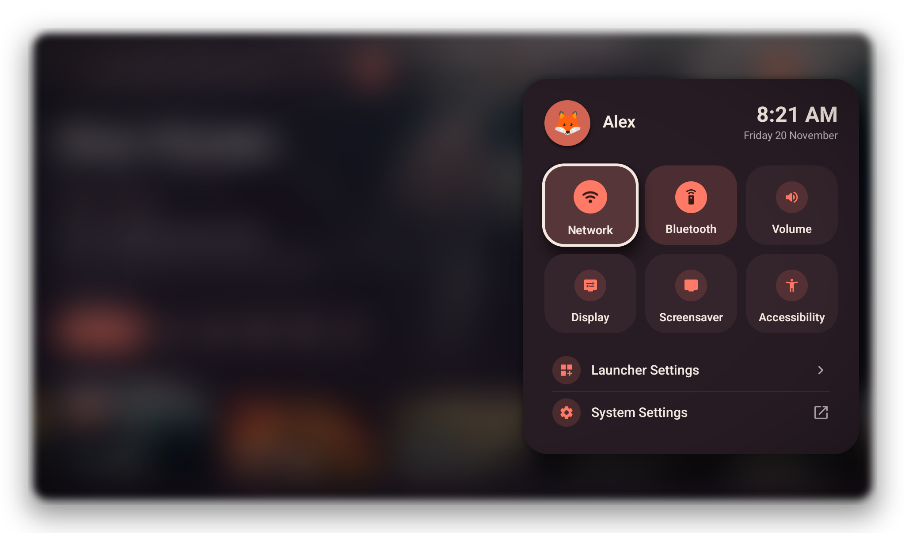
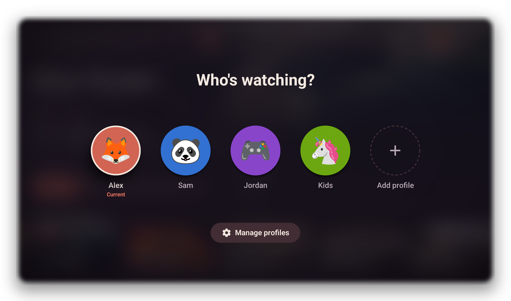
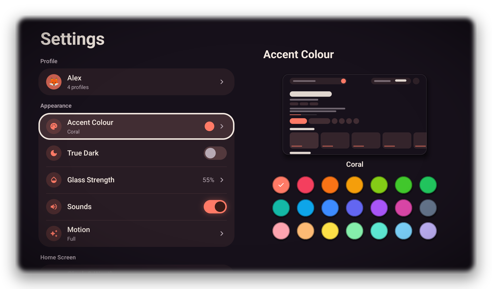

<div align="center">

<p></p>

<a href="../../releases/latest"></a> <a href="../../releases"></a>

     

</div>

---

> [!WARNING]
> **Scene is in alpha.** It works day to day on the device it was built on, but expect rough edges, missing polish and changes between releases. Keep a backup of your settings and [report anything that breaks](../../issues).

Most stock Android TV and Google TV launchers are heavy, slow on budget hardware and full of ads and recommendations you never asked for. Scene is a home screen for **Stremio users**. It puts what you are watching in Stremio front and centre, keeps your other apps one row below, and does nothing at all when you are not looking at it.

## 🍿 Built around Stremio

Sign in once by scanning a code with your phone, and Home becomes your Stremio library.

- **Continue watching on Home.** Everything in progress in Stremio, newest first, with a progress bar on each title.
- **New episodes, marked.** Series you follow show how many new episodes are waiting, and the row picks the right next episode for you.
- **Full-screen spotlight.** Artwork, synopsis, rating and runtime for whatever is in focus, straight from Cinemeta.
- **Play in one press.** OK opens the title in Stremio at the right episode, ready to resume.
- **Manage your library from Home.** Mark an episode or film watched, add or remove titles, hide something from the row, and turn new-episode alerts on or off. Changes go back to your Stremio account.
- **Search Stremio's catalogue.** Films and series from Cinemeta sit alongside your apps and settings in one search, with popular titles shown before you type.
- **Your sign-in stays on the TV.** The Stremio session is encrypted with the Android Keystore and never leaves the device or appears in a backup.

Scene uses Stremio's own account and library, so whatever you do in Stremio shows up on Home, and the other way round.

## ✨ What it does

| | Feature | Details |
|---|---|---|
| 📺 | **Apps** | Pinned or recent apps under the spotlight, plus an All apps grid. Pin, rename, move, sort and hide anything. |
| 🔎 | **Search** | Films, series, apps and settings in one place, with voice search. |
| 👥 | **Profiles** | Up to 8 profiles, each with its own Home, accent and picture. Optional D-pad passcodes, admin and standard roles, and a recovery code. |
| ⚡ | **Quick panel** | Network, Bluetooth, volume, display, screensaver and accessibility, one press away. |
| 🎨 | **Make it yours** | 21 accent colours, True Dark, adjustable glass, motion levels and optional sounds. |
| 🌤️ | **Clock and weather** | 12 or 24 hour clock, with weather for where you are or a city you pick. |
| 🌙 | **Screensaver** | An ambient artwork screensaver or a simple clock. |
| 💾 | **Backup** | Export each profile's settings to one file and restore it later. |

## 📱 Screenshots

<p align="center">
  
  
</p>
<p align="center">
  
  
</p>
<p align="center">
  
  
</p>

## 🚀 Get started

1. **Download.** Open the [latest release](../../releases/latest) and download `Scene-<version>.apk`.
2. **Install.** Sideload it with a file manager on the TV, or from a computer with `adb install -r Scene-<version>.apk`.
3. **Make it Home.** Press the Home button and pick Scene. If your device does not ask, see [Setting Scene as Home](#-setting-scene-as-home).
4. **Connect Stremio, if you use it.** Open **Settings → Stremio** and scan the code with your phone. Continue watching fills in straight away.

## 📋 Requirements

| | Minimum | Tested on |
|---|---|---|
| **Device** | Any Android TV or Google TV device | onn 4K streaming box |
| **Android** | 8.0 (API 26) | Android 14 (API 34) |
| **Memory** | 1 GB | 2 GB |
| **Processor** | 32-bit or 64-bit ARM, or x86. No native code | 4-core 32-bit ARM |
| **Display** | 720p | 1080p UI on a 4K output |
| **Remote** | D-pad with OK, Back and Home | onn voice remote |
| **Network** | Optional. Needed for Stremio, artwork and weather | Wi-Fi |
| **Storage** | About 250 KB for the APK | |

Scene targets API 36 and is built against API 37. Stremio is optional, and voice search needs a remote or device with a microphone.

A few extras need a newer Android. On 8.0 and 8.1 focus glows are not tinted. On Android 10 and older, local weather uses the device's last known location, so picking a city is more reliable there, and the search screen does not make room for the on-screen keyboard.

## 🔒 Privacy

- **No ads, no analytics, no accounts.** Scene has no server of its own and sends nothing about you anywhere.
- **Direct connections only.** Scene talks to Stremio for your library, Cinemeta for artwork and details, and Open-Meteo for weather. Nothing else.
- **Nothing in the background.** No services, no scheduled jobs. Scene does its work while it is on screen and stops when it is not.
- **Permissions on demand.** The microphone is asked for only when you use voice search, and location only if you choose local weather.
- **Backups stay clean.** Exported files never contain passcodes, recovery codes or your Stremio sign-in.

## 🏠 Setting Scene as Home

Some devices never offer a choice of home screen. The PowerShell scripts in `tools\` handle it over wireless debugging. Put the device address in `tools\device.local` or pass `-Device ip:port`.

1. `.\tools\snapshot.ps1` saves the current state so it can be put back.
2. `.\tools\deploy.ps1 -SetHome` installs Scene and makes it the Home app.
3. Press Home and check that Scene opens. Hold the mic button and check that the Assistant still answers.
4. Optionally, `.\tools\lockdown.ps1` lists system packages that can be turned off to save memory. It changes nothing unless you add `-Apply`.

To go back, run `.\tools\rollback.ps1`. Android TV Settings also keeps a fallback home screen.

<details>
<summary><b>All device scripts</b></summary>

<br>

| Script | Purpose |
|---|---|
| `snapshot.ps1` | Read-only. Saves disabled packages, Home state and memory use to `snapshots\`. |
| `deploy.ps1` | Installs with `adb install -r` and compiles ahead of time. `-SetHome` makes Scene the Home app. |
| `lockdown.ps1` | Turns off optional system packages. Dry run unless `-Apply`. |
| `rollback.ps1` | Restores one package with `-Package`, or every optional package and the stock launcher. |
| `health.ps1` | Read-only. Reports the Home app, packages that came back after an update, start time and memory. |
| `backup.ps1` / `restore.ps1` | Pull or push `scene-backup.json`. |

The scripts never touch the packages that voice and the remote depend on: `com.google.android.gms`, `com.google.android.gsf`, `com.google.android.katniss`, `com.google.android.tts`, `com.google.android.webview`, `com.android.bluetooth`, `com.google.android.tv.remote.service`, `com.android.providers.tv`, `com.android.systemui`, `com.android.tv.settings`, `com.android.vending` and `com.google.android.inputmethod.latin`.

</details>

## ❓ FAQ

<details>
<summary><b>Is it free?</b></summary>

<br>

Yes. Scene is free and open source, with no ads or in-app purchases. If you want to say thanks, there is a [Ko-fi page](https://ko-fi.com/robbydock).

</details>

<details>
<summary><b>Do I need Stremio?</b></summary>

<br>

Scene is made for Stremio users, and Stremio is where it shines. It still works without it as a clean app launcher with search, profiles and a quick panel, but you lose Continue watching, the spotlight and title search.

</details>

<details>
<summary><b>Does voice search still work?</b></summary>

<br>

Yes. The remote's mic button still goes to the Google Assistant, and Scene's own search has a voice button of its own.

</details>

<details>
<summary><b>I forgot a passcode. What now?</b></summary>

<br>

After 5 wrong tries Scene waits 30 seconds, doubling with each miss up to 15 minutes. There are three ways back in:

1. **Admin.** An admin can clear another profile's passcode in **Settings → Profiles**.
2. **Recovery code.** Shown once when an admin first sets a passcode. On the passcode screen, press OK and choose **Use recovery code**.
3. **adb.** Clears every passcode, recovery code and lockout. Profiles and settings stay.

```bash
adb shell am broadcast -a com.robbydock.scene.CLEAR_PASSCODES -n com.robbydock.scene/.AdminReceiver
```

</details>

<details>
<summary><b>How do I update?</b></summary>

<br>

Download the newest APK from [Releases](../../releases) and install it over the old one with `adb install -r`. Your profiles and settings stay in place.

</details>

<details>
<summary><b>Something broke. What now?</b></summary>

<br>

[Open an issue](../../issues) with your device model, Android version and what you pressed before it happened.

</details>

## 🛠️ Build from source

A standard Gradle Android project. You need JDK 17 and an Android SDK with API 37.

```powershell
# Windows
.\gradlew.bat :app:assembleDebug
```

```bash
# macOS and Linux
./gradlew :app:assembleDebug
```

Release builds are signed when `local.properties` has these keys. Use forward slashes in the path. Without them the release build is unsigned.

```properties
release.storeFile=C:/path/to/scene-release.jks
release.storePassword=...
release.keyAlias=scene
release.keyPassword=...
```

Scene is plain Kotlin and Android Views with no runtime libraries at all, which keeps the APK small and the home screen quick on low-memory boxes.

## 🙏 Credits

Scene uses Material Symbols icons and draws profile pictures with the device's emoji font. See [NOTICE](NOTICE) for full attribution.

## 📝 License

Scene is licensed under the [GNU General Public License v3.0 or later](LICENSE). You can use, study, change and share it. If you share a changed version, it must stay open source under the same terms.

Scene is unofficial and is not made by, or affiliated with, Stremio or Google. Stremio's web API is not publicly documented, so a change on their side may need an update here.
